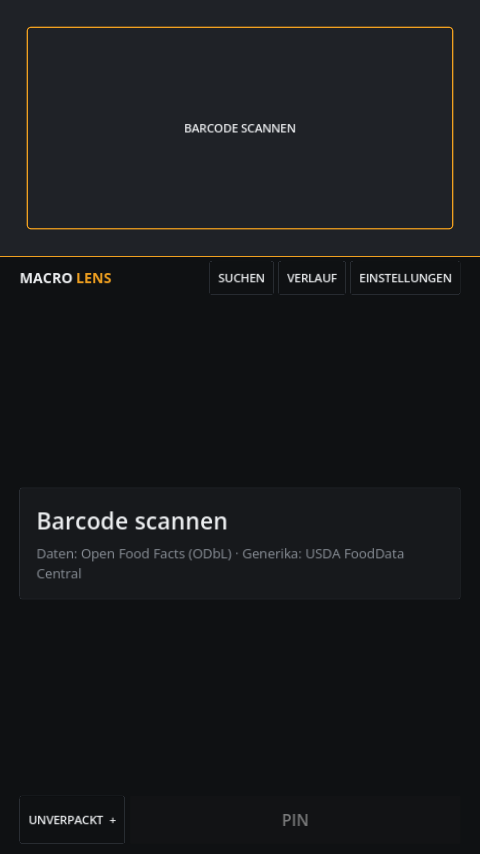

# Macro Lens

**Kamera auf ein Produkt → Barcode erkannt → vier Grafiken.**
Keine Nährwerttabelle zum Lesen, keine Noten, keine Konten, keine Cloud.

Macro Lens ist eine kleine Android-App für gesundheitsbewusste Menschen, die im
Supermarkt **schneller bessere Kaufentscheidungen** treffen wollen. Das Angebot ist
riesig, die Zeit am Regal kurz: Man steht mit zwei Joghurts im Gang und will in
Sekunden wissen, welcher die bessere Wahl ist — ohne Etikett, ohne Rechnerei.

Bewusst **ohne** Mengen, Mahlzeiten oder Tagesbilanz. Die App macht genau eins:
das übervolle Supermarktangebot schnell filtern.

<p align="center">
  
  
  
</p>

Die ganze App ist **ein Screen**: oben die Live-Kameravorschau, darunter die
vier Grafiken und ein **PIN**-Button, der das aktuelle Produkt für den direkten
Vergleich behält (bis zu vier). Keine Menüs, kein Scrollen.

## Was es ist

Ein **Messgerät**, kein Tagebuch. Es scannt durchgehend: Barcode ins obere
Drittel halten, die vier Grafiken darunter aktualisieren sich sofort. **PIN**
behält das Produkt, der nächste Scan erscheint daneben — bis zu vier Produkte
im Vergleich, jedes wieder entfernbar.

Vier Grafiken sagen alles, was die Kaufentscheidung trägt — und nichts wird zu
einer Note zusammengefasst:

| Grafik | Beantwortet die Frage |
|---|---|
| **Makro-Donut** | Woraus kommen die Kalorien (Eiweiß / KH / Fett)? |
| **Kaloriendichte** | Wie viel Energie pro 100 g? |
| **Eiweißdichte** | Wie viel Eiweiß pro 100 kcal? |
| **Sättigung** | Wie füllend pro Kalorie? (Schätzung) |

Bis zu vier Produkte lassen sich nebeneinander vergleichen; der Bestwert je
Zeile ist markiert. Die Entscheidung fällt durch Vergleichen der Bilder, nicht
durch Lesen einer Note.

Bewusst **kein** Nutri-Score, keine A–E-Note, kein Score. Fehlt ein
Eingangswert, entfällt die betroffene Grafik — es wird nie geraten.

## Was es nicht ist

Kein Konto, keine Cloud, keine Werbung, keine Telemetrie, kein Tracking, kein
Kalender, keine Tagesziele. Alles bleibt auf dem Gerät. Nach außen geht nur der
Barcode an Open Food Facts.

## Funktionen

- **Dauerscan**: Live-Kameravorschau (CameraX) mit On-Device-ML-Kit-Barcode-Decoder
  (gebündelt, ohne Play-Services-Zwang) — EAN-8/13, UPC-A/E, Code 128, Code 39,
  ITF. Barcode reinhalten, Grafiken aktualisieren.
- **PIN & Vergleich**: aktuelles Produkt behalten, nächstes scannen, bis zu vier
  nebeneinander; Bestwert je Grafik markiert, jedes wieder entfernbar.
- **Unverpackt-Liste** (~65 Grundnahrungsmittel: Banane, Haferflocken, Hähnchen,
  Skyr …), direkt in den Vergleich übernehmbar, vollständig offline.
- **Namenssuche** über Open Food Facts.
- **Offline-Cache**: jedes gescannte Produkt wird lokal gemerkt.
- **Verlauf** mit Suche, **manuelle Barcode-Eingabe** als Fallback.
- **Deutsch / Englisch**, Hell / Dunkel.

## Daten

Die Nährwerte stammen aus [Open Food Facts](https://world.openfoodfacts.org) (ODbL).
Die Unverpackt-Liste basiert auf USDA FoodData Central (public domain).
Die Barcode-Erkennung läuft on-device über den gebündelten ML-Kit-Scanner (CameraX-Vorschau).

> Daten: Open Food Facts (ODbL) · Generika: USDA FoodData Central

## Download

Das neueste signierte APK gibt es unter [Releases](../../releases/latest)
(arm64-v8a, ab Android 7). Herunterladen, installieren, fertig. Da die App nicht
über Google Play verteilt wird, fragt Android einmalig nach der Erlaubnis,
Apps aus unbekannten Quellen zu installieren.

## Aus dem Quelltext bauen

Voraussetzungen: Linux, [Godot 4.7](https://godotengine.org), JDK 17, Android-SDK
(Platform + Build-Tools 36) und ein passendes NDK, dazu ein Release-Keystore.

Die Skripte nehmen die während der Entwicklung genutzte Toolchain an
(`~/.local/opt/shadegunner-tools/`); überschreibbar über `SHADEGUNNER_TOOLS`,
`JAVA_HOME` und `ANDROID_HOME`.

```bash
# 1) Godot-Android-Build-Template installieren (und lokales NDK setzen)
tools/setup_build_template.sh

# 2) Barcode-Plugin-AAR bauen -> addons/macrolens/macrolens-barcode.aar
tools/build_plugin.sh

# 3) Signier-Konfiguration anlegen
cp export_presets.cfg.example export_presets.cfg   # Keystore + Passwort eintragen

# 4) signierte Release-APK exportieren -> build/macro-lens.apk
tools/build_apk.sh
```

Tests der reinen Rechenlogik:

```bash
godot --headless --path . --script res://tests/test_metrics.gd
godot --headless --path . --script res://tests/test_app.gd
```

Screenshots aller Screens (Demo-Daten):

```bash
tools/shots.sh
```

## Projektstruktur

```
src/
  food.gd            Datenmodell (alles pro 100 g, -1 = fehlt)
  metrics.gd         die vier Grafiken — reine Rechnung, getestet
  off_client.gd      Open-Food-Facts-Client (User-Agent, Backoff, Cache)
  generics.gd        mitgelieferte Unverpackt-Liste
  store.gd           lokale Persistenz (Cache, Verlauf, Einstellungen)
  i18n.gd            DE/EN-Texte
  app.gd             Zustand, Navigation, Ablage, Screenshot-Harness
  ui/                Design-System (Palette, Karten, Buttons, Typografie)
  widgets/           Makro-Donut, Kaloriendichte-Skala, Balken
  screens/           live (Dauerscan), Unverpackt, Suche, Verlauf, …
data/generics.json   Unverpackt-Liste (pro 100 g)
plugins/macrolens-barcode/   Kotlin-Quelle des Godot-Android-Plugins
addons/macrolens/    gepacktes Plugin (AAR + Export-Plugin)
tests/               Unit-Tests der Rechenlogik
```

Die Rechnung (`metrics.gd`) ist bewusst von Netz und UI getrennt und lässt sich
gegen echte Etiketten prüfen, ohne die App zu starten.

## Stand

Früh, aber benutzbar. Der Weg Scannen → Lookup → vier Grafiken → Vergleich
funktioniert durchgängig. Geplant: Mengen-Umschalter,
Play-Store-Build (AAB) mit optionaler Unterstützer-Option.

## Lizenz

MIT — siehe [LICENSE](LICENSE). Nährwertdaten: Open Food Facts (ODbL).
