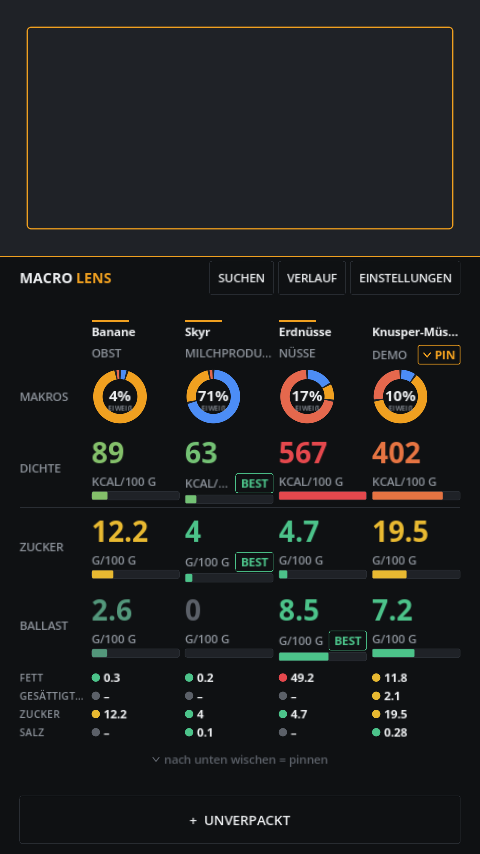
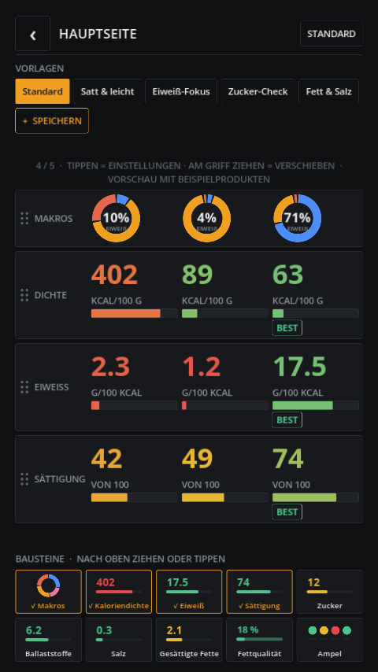

# Macro Lens

**Point the camera at a product → barcode scanned → the charts you care about.**
No nutrition table to read, no letter grades, no accounts, no cloud.

Macro Lens is a small Android app for health-conscious people who want to make
**faster, better buying decisions in the supermarket**. The shelves are crowded,
time in the aisle is short: you're standing there with two yoghurts in your hand
and want to know which one is the better pick — in seconds, without reading labels.

It deliberately does **not** track quantities, meals or days. It does one thing:
filter a crowded supermarket offering, fast.

<p align="center">
  
  
  
</p>

The whole app is **one screen**: a live camera preview on top, the charts
below — four by default, or up to five building blocks you pick yourself.
**Swipe a column down to pin it** for side-by-side comparison (up to four),
**swipe it up to remove it**. No buttons for that, no menus, no scrolling.

## What it is

A **measuring device**, not a diary. It scans continuously: hold a barcode into
the top third of the screen and the four charts below update immediately. Swipe
the column **down** to pin the product; the next scan appears beside it — up to
four products compared at once. Swipe a column **up** to throw it out again.

By default four charts tell you what the buying decision needs — and nothing is
summarised into a score. In the settings you can build your own home screen
from **up to five of ten building blocks** (five fit without scrolling):

| Block | Question it answers | Options |
|---|---|---|
| **Macro donut** *(default)* | Where do the calories come from? | sugar as its own slice, centre value |
| **Calorie density** *(default)* | How energy-dense is it? | per 100 g / serving / pack |
| **Protein** *(default)* | How much protein per 100 kcal? | per 100 kcal or grams per 100 g / serving / pack |
| **Satiety** *(default)* | How filling is it per calorie? (estimate) | Satiety 2.0 or classic Fullness Factor |
| **Sugar** | How much sugar? | g, % of carbs, per 100 kcal, % of energy; per 100 g / serving / pack |
| **Fibre** | How much fibre? | g or per 100 kcal; per 100 g / serving / pack |
| **Salt** | How much salt? | salt in g or sodium in mg; per 100 g / serving / pack |
| **Saturated fat** | How much saturated fat? | g, % of fat, % of energy |
| **Fat quality** | How much of the fat is saturated? | — |
| **Traffic light** | Fat, saturates, sugar, salt at a glance | rows on/off, optional fibre and protein |

Every block can mark the **BEST** product of the row. Colours always describe the
food itself (per 100 g / 100 ml), bar lengths the shown value — so "red" stays
honest even "per pack".

Five **presets** (Standard, Full & light, Protein focus, Sugar check, Fat & salt)
plus your **own saved presets**. The editor works by drag & drop: pull a block
from the dock into the preview (it snaps in), drag to reorder, drag back into the
dock to remove; tap a block for its settings. Everything is saved immediately.

The app deliberately has **no** Nutri-Score letters, no A–E grade, no overall
score — the traffic light shows single lights, never a grade. If an input value
is missing, the affected value is dropped — it never guesses.

### Satiety 2.0

Satiety is an estimate per calorie (0–100). Its core is the published
**Fullness Factor** (fitted to the satiety index data of Holt et al. 1995:
energy density, protein, fibre, fat, with the original caps). On top it weighs
what the Fullness Factor misses per calorie: **fibre per 100 kcal** (up to +8),
**protein per 100 kcal** (up to +6), and **sugar**: a penalty above 25 % sugar
energy (up to −15) and, for drinks, a penalty proportional to the sugar share
(up to −30) because liquid sugar calories are barely compensated. Missing fibre
or sugar values only drop their own term. The classic Fullness Factor can be
selected in the block settings.

### Thresholds

Traffic-light colours use the UK Food Standards Agency front-of-pack thresholds
(per 100 g; stricter per 100 ml for drinks). Fibre and protein use the EU claim
levels for "source of" / "high in". Guidance, not a medical assessment.

## What it is not

No account, no cloud, no ads, no telemetry, no tracking, no calendar, no targets.
Everything stays on the device. The only things that leave the phone are the
barcode (or a search term) sent to Open Food Facts — and, for barcodes Open Food
Facts doesn't know, the barcode sent to its sister projects Open Products Facts
and Open Beauty Facts.

## Features

- **Continuous scan**: a live camera preview (CameraX) with an on-device ML Kit
  barcode decoder (bundled, no Play Services needed) — EAN-8/13, UPC-A/E,
  Code 128, Code 39, ITF. Hold a barcode in front of it and the charts update.
- **Swipe to compare**: swipe down = pin, swipe up = remove; compare up to four
  side by side, the best value per chart is marked.
- **Custom home screen**: up to five of ten building blocks, five presets, your
  own presets, drag & drop editor, per-block settings (sticky).
- **Per 100 g, per serving or per pack**: serving and pack sizes are parsed from
  the label ("4 x 125 g", "1,5 l", "1 portion (30 g)"). Drinks are converted
  1 ml ≈ 1 g (can be switched off in the settings).
- **Not food?** If Open Food Facts doesn't know a barcode, the app asks Open
  Products Facts and Open Beauty Facts — scanning detergent gets you "Cleaning
  products are not breakfast" instead of a network error.
- **Robust lookups**: "not found" vs. "rate limit" vs. "no connection" are told
  apart; product and search requests are throttled separately; searches are
  cached and de-duplicated; search uses Search-a-licious with the classic search
  as fallback.
- **Optional X** to close the app immediately (settings).
- **Allergens & intolerances** (settings): pick from the 14 major EU allergens
  ("Nuts (all)" includes peanuts, plus "Peanuts only") and lactose, fructose,
  sorbitol, caffeine, histamine. A scanned product that contains a selected
  allergy is highlighted **red** (three strong vibrations), an intolerance or an
  allergen trace **orange** (one strong vibration); a banner says why, tapping a
  flagged column lists everything. Detection uses Open Food Facts allergen tags,
  traces and the ingredient list (German/English keywords, negations like
  "ohne Milch", traps like coconut milk or cocoa butter, "lactose-free" /
  "gluten-free" claims); basic foods are curated. Missing ingredients show
  "not checked" — the app never claims "safe". **A help, not a guarantee:
  always read the label.** The selection stays on the device.
- **Unpackaged basics** (~65 staples: banana, oats, chicken, skyr, …) that can be
  added to the comparison and works fully offline.
- **Name search** through Open Food Facts.
- **Offline cache**: every scanned product is remembered.
- **History** with search, **manual barcode entry** as a fallback.
- **German / English**, light / dark.

## Data

Nutrition data comes from [Open Food Facts](https://world.openfoodfacts.org) (ODbL).
The unpackaged basics list is based on USDA FoodData Central (public domain).
Barcode decoding runs on-device via the bundled ML Kit scanner (CameraX preview).

> Data: Open Food Facts (ODbL) · Basics: USDA FoodData Central · Non-food: Open Products Facts, Open Beauty Facts

## Download

Grab the latest signed APK from the [Releases](../../releases/latest) page
(arm64-v8a, Android 7+). Sideload it and open it — that's it.
Because the APK is not distributed through Google Play, Android may show a
one-time "install from unknown sources" prompt.

## Build from source

Requirements: Linux, [Godot 4.7](https://godotengine.org), JDK 17, the Android
SDK (platform + build-tools 36) and a matching NDK, plus a release keystore.

The scripts assume the toolchain layout used during development
(`~/.local/opt/shadegunner-tools/`); override via `SHADEGUNNER_TOOLS`, `JAVA_HOME`
and `ANDROID_HOME`.

```bash
# 1) install the Godot Android build template (and pin the local NDK)
tools/setup_build_template.sh

# 2) build the barcode plugin AAR -> addons/macrolens/macrolens-barcode.aar
tools/build_plugin.sh

# 3) create your signing config
cp export_presets.cfg.example export_presets.cfg   # fill in keystore + password

# 4) export a signed release APK -> build/macro-lens.apk
tools/build_apk.sh
```

Run the tests (metrics, app state, gestures, network/non-food, layout & editor):

```bash
godot --headless --path . --script res://tests/test_metrics.gd
godot --headless --path . --script res://tests/test_app.gd
godot --headless --path . --script res://tests/test_gesture.gd
godot --headless --path . --script res://tests/test_off.gd
godot --headless --path . --script res://tests/test_layout.gd
godot --headless --path . --script res://tests/test_allergens.gd
```

Render screenshots of all screens (demo data):

```bash
tools/shots.sh
```

## Project layout

```
src/
  food.gd            data model (all values per 100 g, -1 = missing)
  metrics.gd         the math behind every chart (bases, thresholds, satiety) — tested
  blocks.gd          the ten building blocks: catalogue, options, evaluation
  layout.gd          home-screen layout, presets, own presets
  nonfood.gd         non-food classification and messages
  allergens.gd       allergens & intolerances: catalogue and detection
  off_client.gd      Open Food Facts client (error classes, throttles, caches, non-food)
  generics.gd        bundled unpackaged-basics list
  store.gd           local persistence (cache, history, settings)
  i18n.gd            DE/EN strings
  app.gd             state, navigation, tray, screenshot harness
  ui/                design system (palette, cards, buttons, type)
  widgets/           macro donut, meter bar
  screens/           live (continuous scan), layout editor, generics, search, history, settings, about
assets/about/        portrait for the About page
data/generics.json   unpackaged basics (per 100 g)
plugins/macrolens-barcode/   Kotlin source of the Godot Android plugin
addons/macrolens/    packaged plugin (AAR + export plugin)
tests/               unit and UI tests
```

The math (`metrics.gd`) is deliberately separate from any network or UI code, so
it can be verified against real labels without running the app.

## Status

Usable day to day. Scanning → lookup → charts → comparison works end to end;
the home screen is customisable since 0.4.0, allergen and intolerance
warnings since 0.5.0. Planned next: Play Store build
(AAB) with an optional supporter option.

## License

MIT — see [LICENSE](LICENSE). Nutrition data: Open Food Facts (ODbL).
