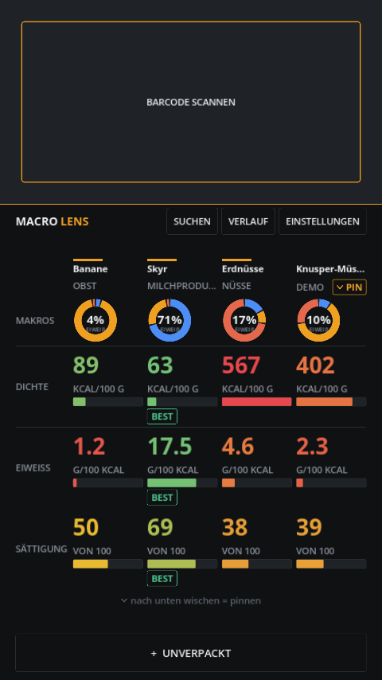
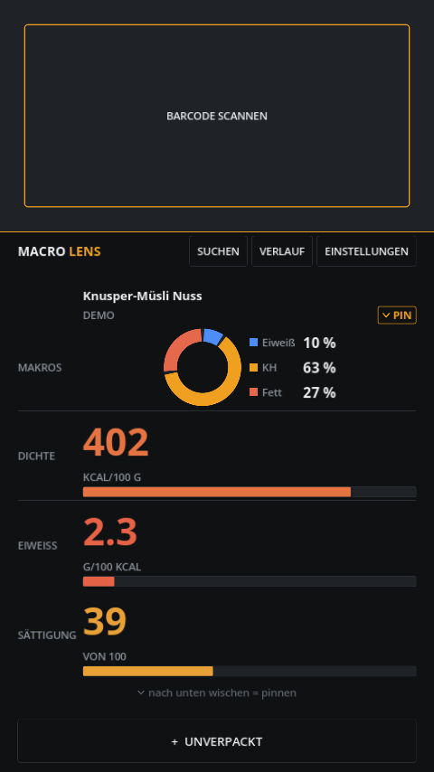
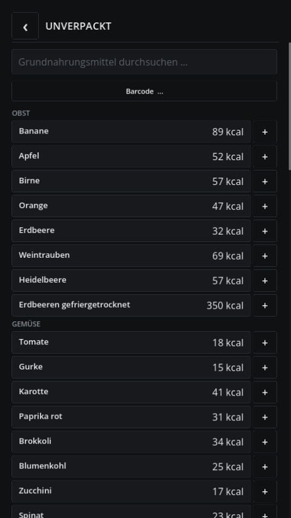

# Macro Lens

**Point the camera at a product → barcode scanned → four charts.**
No nutrition table to read, no letter grades, no accounts, no cloud.

Macro Lens is a small Android app for health-conscious people who want to make
**faster, better buying decisions in the supermarket**. The shelves are crowded,
time in the aisle is short: you're standing there with two yoghurts in your hand
and want to know which one is the better pick — in seconds, without reading labels.

It deliberately does **not** track quantities, meals or days. It does one thing:
filter a crowded supermarket offering, fast.

<p align="center">
  
  
  
</p>

The whole app is **one screen**: a live camera preview on top, the four charts
below. **Swipe a column down to pin it** for side-by-side comparison (up to
four), **swipe it up to remove it**. No buttons for that, no menus, no scrolling.

## What it is

A **measuring device**, not a diary. It scans continuously: hold a barcode into
the top third of the screen and the four charts below update immediately. Swipe
the column **down** to pin the product; the next scan appears beside it — up to
four products compared at once. Swipe a column **up** to throw it out again.

Four charts tell you everything the buying decision needs — and nothing is
summarised into a score:

| Chart | Question it answers |
|---|---|
| **Macro donut** | Where do the calories come from (protein / carbs / fat)? |
| **Calorie density** | How energy-dense is it per 100 g? |
| **Protein density** | How much protein do you get per 100 kcal? |
| **Satiety** | How filling is it per calorie? (estimate) |

Up to four products can be compared side by side; the best value per row is
marked. The decision is made by comparing the pictures, not by reading a grade.

The app deliberately has **no** Nutri-Score letters, no A–E grade, no score.
If an input value is missing, the affected chart is dropped — it never guesses.

## What it is not

No account, no cloud, no ads, no telemetry, no tracking, no calendar, no targets.
Everything stays on the device. The only thing that leaves the phone is the
barcode sent to Open Food Facts.

## Features

- **Continuous scan**: a live camera preview (CameraX) with an on-device ML Kit
  barcode decoder (bundled, no Play Services needed) — EAN-8/13, UPC-A/E,
  Code 128, Code 39, ITF. Hold a barcode in front of it and the charts update.
- **Swipe to compare**: swipe down = pin, swipe up = remove; compare up to four
  side by side, the best value per chart is marked.
- **Unpackaged basics** (~65 staples: banana, oats, chicken, skyr, …) that can be
  added to the comparison and works fully offline.
- **Name search** through Open Food Facts.
- **Offline cache**: every scanned product is remembered.
- **History** with search, **manual barcode entry** as a fallback.
- **German / English**, light / dark.

## Data

Nutrition data comes from [Open Food Facts](https://world.openfoodfacts.org) (ODbL).
The unpackaged basics list is based on USDA FoodData Central (public domain).
Barcode decoding runs on-device via the bundled ML Kit scanner (CameraX preview).

> Data: Open Food Facts (ODbL) · Basics: USDA FoodData Central

## Download

Grab the latest signed APK from the [Releases](../../releases/latest) page
(arm64-v8a, Android 7+). Sideload it and open it — that's it.
Because the APK is not distributed through Google Play, Android may show a
one-time "install from unknown sources" prompt.

## Build from source

Requirements: Linux, [Godot 4.7](https://godotengine.org), JDK 17, the Android
SDK (platform + build-tools 36) and a matching NDK, plus a release keystore.

The scripts assume the toolchain layout used during development
(`~/.local/opt/shadegunner-tools/`); override via `SHADEGUNNER_TOOLS`, `JAVA_HOME`
and `ANDROID_HOME`.

```bash
# 1) install the Godot Android build template (and pin the local NDK)
tools/setup_build_template.sh

# 2) build the barcode plugin AAR -> addons/macrolens/macrolens-barcode.aar
tools/build_plugin.sh

# 3) create your signing config
cp export_presets.cfg.example export_presets.cfg   # fill in keystore + password

# 4) export a signed release APK -> build/macro-lens.apk
tools/build_apk.sh
```

Run the unit tests for the pure metric logic:

```bash
godot --headless --path . --script res://tests/test_metrics.gd
godot --headless --path . --script res://tests/test_app.gd
godot --headless --path . --script res://tests/test_gesture.gd
```

Render screenshots of all screens (demo data):

```bash
tools/shots.sh
```

## Project layout

```
src/
  food.gd            data model (all values per 100 g, -1 = missing)
  metrics.gd         the four charts — pure math, fully tested
  off_client.gd      Open Food Facts client (user-agent, backoff, cache)
  generics.gd        bundled unpackaged-basics list
  store.gd           local persistence (cache, history, settings)
  i18n.gd            DE/EN strings
  app.gd             state, navigation, tray, screenshot harness
  ui/                design system (palette, cards, buttons, type)
  widgets/           macro donut, calorie-density scale, meter bar
  screens/           live (continuous scan), generics, search, history, settings, …
data/generics.json   unpackaged basics (per 100 g)
plugins/macrolens-barcode/   Kotlin source of the Godot Android plugin
addons/macrolens/    packaged plugin (AAR + export plugin)
tests/               unit tests for the metric math
```

The math (`metrics.gd`) is deliberately separate from any network or UI code, so
it can be verified against real labels without running the app.

## Status

Early but usable. The scanning → lookup → four charts → comparison path works
end to end. Planned next: portion switching, Play Store build
(AAB) with an optional supporter option.

## License

MIT — see [LICENSE](LICENSE). Nutrition data: Open Food Facts (ODbL).
